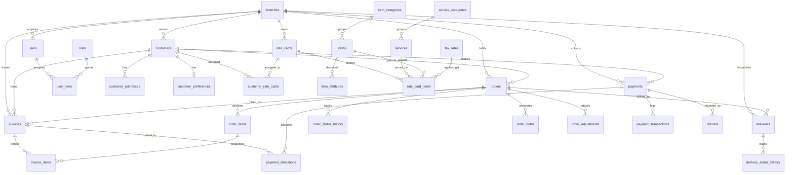

# FreshFold Laundry Management Backend — Schema Inventory & ER Diagram

## Overview

- **Database:** Cloudflare D1 (SQLite)
- **ORM / Migrations:** Drizzle ORM (`drizzle-orm/d1`) + Drizzle Kit generating reviewed SQL under `migrations/api/`
- **File Storage:** Cloudflare R2 (`STORAGE` binding) — D1 stores only R2 object keys and metadata (zero BLOB/Base64 payloads)
- **Monetary Precision:** Integer **paise** (`₹250.50` = `25050`), **BigInt HALF-UP** rounding
- **Weight Precision:** Integer **grams** (`1.5 kg` = `1500`)
- **Tax Precision:** Integer **basis points** (`18%` = `1800`, `5%` = `500`)
- **Timestamps:** UTC ISO-8601 text (`YYYY-MM-DDTHH:mm:ss.sssZ`)

> [!IMPORTANT]
> **Documented Table Adjustment (32 Tables vs 33 Proposed):**
> Per `ADR-015` and project decision, **Supabase Auth** is the sole authentication and session provider. `users`, `roles`, and `user_roles` are implemented in D1 (mapped via `users.supabase_user_id` with **no password hashes**). The local `sessions` table is intentionally omitted so no parallel auth or session-token store exists in D1.

---

## Entity-Relationship Diagram

---

## Complete Table Inventory (32 Tables)

| # | Module | Table | Primary Key / Unique Business Keys | Key FK Deletion Policies | Notable DB Protections |
|---|---|---|---|---|---|
| 1 | Branch | `branches` | `id`, `uq_branches_code` | — | `state_code` 2-char check, `is_default` / `is_active` flags |
| 2 | Customer | `customers` | `id`, `uq_customers_code` | `branch_id` `RESTRICT` | Phone & `(branch_id, created_at, id)` cursor index, soft-delete `deleted_at` |
| 3 | Customer | `customer_addresses` | `id` | `customer_id` `CASCADE` | `address_type` enum check, 2-char `state_code` |
| 4 | Customer | `customer_preferences` | `id`, `uq_customer_preferences_customer_id` | `customer_id` `CASCADE` | 1:1 customer preferences |
| 5 | Catalog | `item_categories` | `id`, `uq_item_categories_code` | — | Active + sort-order index |
| 6 | Catalog | `items` | `id`, `uq_items_code` | `category_id` `RESTRICT` | `image_r2_key` (R2 key only), non-negative `image_size_bytes` |
| 7 | Catalog | `item_attributes` | `id`, `uq_item_attributes_item_key` | `item_id` `CASCADE` | Key/value garment metadata |
| 8 | Catalog | `service_categories` | `id`, `uq_service_categories_code` | — | Active + sort-order index |
| 9 | Catalog | `services` | `id`, `uq_services_code` | `category_id` `RESTRICT` | `default_pricing_basis` (`per_item`/`per_kg`), positive turnaround |
| 10 | Pricing & Tax | `tax_rates` | `id`, `uq_tax_rates_code_from` | — | Basis points (`0..10000`), `cgst + sgst = total`, `igst = total`, effective range |
| 11 | Pricing & Tax | `rate_cards` | `id`, `uq_rate_cards_code` | `branch_id` `RESTRICT` | Branch default lookup index, effective range |
| 12 | Pricing & Tax | `rate_card_items` | `id`, `uq_rate_card_items_key_from`, partial `uq_rate_card_items_open_active` | `rate_card_id`/`service_id`/`item_id`/`tax_rate_id` `RESTRICT` | Non-null `pricing_key` solves SQLite nullable `item_id` uniqueness; `trg_rci_no_overlap_*` triggers block effective-date overlaps |
| 13 | Pricing & Tax | `customer_rate_cards` | `id`, partial `uq_customer_rate_cards_active_open` | `customer_id`/`rate_card_id` `RESTRICT` | Effective-dated customer-specific rate cards |
| 14 | Orders | `orders` | `id`, `uq_orders_order_number` | `branch_id`/`customer_id`/`rate_card_id` `RESTRICT`; addresses/actor `SET NULL` | Snapshot GST & paise totals, `trg_orders_no_delete`, cursor indexes by customer/status/branch |
| 15 | Orders | `order_items` | `id` | `order_id`/`service_id`/`item_id`/`tax_rate_id` `RESTRICT` | Immutable catalog/price/GST snapshots; `per_item` requires `quantity_pieces > 0`, `per_kg` requires `weight_grams > 0` |
| 16 | Orders | `order_status_history` | `id` | `order_id` `RESTRICT`, `changed_by_user_id` `SET NULL` | Append-only order transition log |
| 17 | Orders | `order_notes` | `id` | `order_id` `CASCADE`, `created_by_user_id` `SET NULL` | Internal & customer notes |
| 18 | Orders | `order_adjustments` | `id` | `order_id` `RESTRICT`, `created_by_user_id` `SET NULL` | Signed paise adjustments (discount/surcharge/express/delivery/rounding) |
| 19 | Billing | `invoices` | `id`, `uq_invoices_invoice_number` | `branch_id`/`order_id`/`customer_id` `RESTRICT` | Immutable GST document snapshots, `pdf_r2_key`, `trg_invoices_immutable_financials`, `trg_invoices_no_delete` |
| 20 | Billing | `invoice_items` | `id` | `invoice_id` `RESTRICT`, `order_item_id` -> `order_items.id` `RESTRICT` | Immutable HSN/SAC & GST split line snapshots |
| 21 | Billing | `payments` | `id`, `uq_payments_payment_number` | `branch_id`/`customer_id`/`order_id` `RESTRICT` | `refunded_amount_paise <= captured_amount_paise`, `trg_payments_no_delete` |
| 22 | Billing | `payment_transactions` | `id`, partial `uq_payment_transactions_provider_event` | `payment_id` `RESTRICT` | Redacted provider references only; duplicate webhook event protection |
| 23 | Billing | `refunds` | `id`, `uq_refunds_refund_number` | `payment_id`/`invoice_id` `RESTRICT` | Positive refund amount, `trg_refunds_no_delete` |
| 24 | Billing | `payment_allocations` | `id` | `payment_id`/`invoice_id` `RESTRICT` | Many-to-many payment-to-invoice settlement ledger |
| 25 | Delivery | `deliveries` | `id` | `branch_id`/`order_id`/`customer_id` `RESTRICT`, `customer_address_id` `SET NULL` | Immutable `address_snapshot_json`, `proof_r2_key`, `(status, scheduled_at, id)` index |
| 26 | Delivery | `delivery_status_history` | `id` | `delivery_id` `CASCADE`, `changed_by_user_id` `SET NULL` | Append-only pickup/delivery transition log |
| 27 | Access | `users` | `id`, `uq_users_supabase_user_id`, `uq_users_email` | `branch_id` `RESTRICT` | Links verified Supabase Auth `sub` to staff record (no passwords) |
| 28 | Access | `roles` | `id`, `uq_roles_code` | — | RBAC role definitions |
| 29 | Access | `user_roles` | `id`, `uq_user_roles_user_role` | `user_id`/`role_id` `CASCADE` | Staff role assignments |
| 30 | System | `audit_logs` | `id` | `actor_user_id` `SET NULL` | Indexed by `(created_at, id)` and `(entity_type, entity_id)` |
| 31 | System | `app_settings` | `id`, `uq_app_settings_key` | `updated_by_user_id` `SET NULL` | JSON business & GST configuration |
| 32 | System | `idempotency_keys` | `id`, `uq_idempotency_operation_key` | — | Operation-scoped replay & payload-hash mismatch protection |
